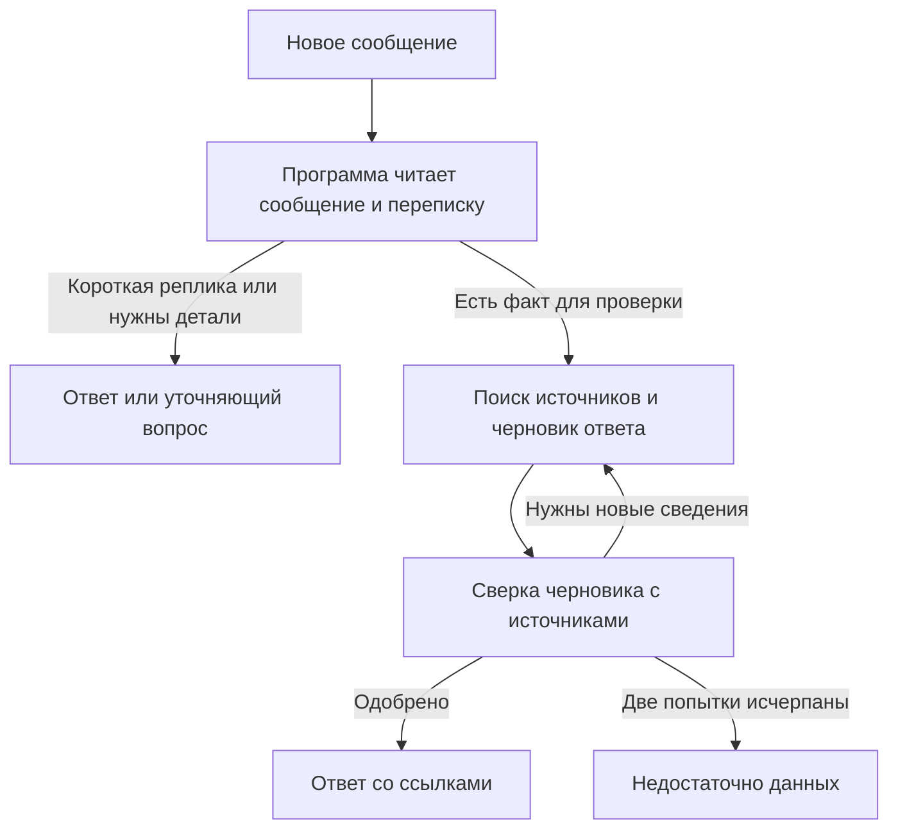

# FactChecker

Учебная программа для проверки фактов. Напишите утверждение или задайте вопрос. Программа найдёт источники, сверит с ними ответ и приведёт ссылки. Например, на вопрос «Кто первым ступил на Луну?» ответ начнётся так: «Нил Армстронг первым ступил на Луну».

## Быстрый запуск на Windows

Если `.venv` и `.env` уже настроены, откройте PowerShell в папке проекта и выполните:

```powershell
.\.venv\Scripts\python.exe main.py
```

После запуска откройте [страницу проверки запросов](http://127.0.0.1:8000/docs). Чтобы остановить программу, нажмите **Ctrl+C** в PowerShell.

## Установка с нуля

Установите Git и Python 3.11 или новее. Если проект ещё не скачан, выполните в PowerShell:

```powershell
git clone https://github.com/Viacheslav-hub-blip/factchecker.git
Set-Location factchecker
```

Из папки проекта выполните:

```powershell
python -m venv .venv
.\.venv\Scripts\python.exe -m pip install -r requirements.txt
if (-not (Test-Path .env)) { Copy-Item .env.example .env }
```

Откройте `.env` и укажите ключ GigaChat в `GIGACHAT_CREDENTIALS`, а ключ Tavily в `TAVILY_API_KEY`. Этот файл хранится на вашем компьютере. По умолчанию используется `GigaChat-3-Pro`. Для доступа к `GigaChat-3-Ultra` через ключ для физического лица укажите `GIGACHAT_MODEL=GigaChat-3-Ultra` и `GIGACHAT_SCOPE=GIGACHAT_API_PERS`. Если при подключении появится ошибка проверки сертификата, укажите путь к сертификату в `GIGACHAT_CA_BUNDLE_FILE`. Затем выполните команду быстрого запуска.

## Пример диалога

На [странице проверки запросов](http://127.0.0.1:8000/docs) откройте `POST /chat` и нажмите **Try it out**. Вставьте текст запроса и нажмите **Execute**.

Для быстрой проверки можно отправить `{"message": "Что ты умеешь?"}`. Программа объяснит, чем может помочь.

1. Начните с вопроса без названия события. Программа попросит уточнить, о чём речь.

   ```json
   {
     "message": "Проверь, правда ли это произошло в 1969 году."
   }
   ```

2. Скопируйте значение `thread_id` из первого ответа, вставьте его вместо `НОМЕР_ДИАЛОГА` и отправьте уточнение. Программа возьмёт год из первого сообщения и проверит факт.

   ```json
   {
     "message": "Речь о первой высадке людей на Луну.",
     "thread_id": "НОМЕР_ДИАЛОГА"
   }
   ```

В поле `answer` будет ответ, в `thread_id` — номер диалога, а в `route` — выбранное действие. Значение `clarify` означает короткий ответ или уточнение, `research` — проверку факта.

## Как проходит проверка



Программа ищет и читает страницы через Tavily и дополнительно ищет статьи в Википедии. Для поиска в Википедии ключ не нужен. Затем программа готовит ответ и отдельно сверяет его с прочитанным. Если вывод требует исправлений, она меняет поисковый запрос, ищет ещё раз и заново проверяет ответ.

Чтобы продолжить разговор, передайте тот же `thread_id`. Запрос без этого поля начинает новый разговор. После остановки программы переписка очищается.

Например, после вопроса «Кто первым ступил на Луну?» можно спросить «А кто вторым?» с тем же `thread_id`. Программа возьмёт событие из предыдущего вопроса и проверит, кто ступил на Луну вторым.
