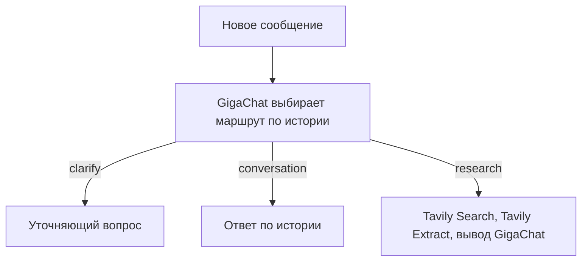

# FactChecker

Учебный агент на GigaChat, LangGraph и FastAPI. Принимает утверждение, ищет страницы через Tavily Search, читает их через Tavily Extract и возвращает вывод со ссылками.

## Быстрый запуск на Windows

Если `.venv` и `.env` уже настроены, откройте PowerShell в папке проекта и выполните:

```powershell
.\.venv\Scripts\python.exe -m uvicorn app:app --host 127.0.0.1 --port 8000
```

После запуска откройте [Swagger UI](http://127.0.0.1:8000/docs). Для остановки сервера нажмите **Ctrl+C** в PowerShell.

## Установка с нуля

Установите Python 3.11 или новее и выполните из папки проекта:

```powershell
python -m venv .venv
.\.venv\Scripts\python.exe -m pip install -r requirements.txt
if (-not (Test-Path .env)) { Copy-Item .env.example .env }
```

Заполните `GIGACHAT_CREDENTIALS` и `TAVILY_API_KEY` в `.env`. Шаблон использует `GigaChat-3-Pro`. Если у вашего ключа есть доступ к Ultra, укажите `GIGACHAT_MODEL=GigaChat-3-Ultra` и `GIGACHAT_SCOPE=GIGACHAT_API_PERS`. При ошибке проверки сертификата укажите путь к файлу сертификата в `GIGACHAT_CA_BUNDLE_FILE`. Затем выполните команду из раздела быстрого запуска.

## Проверка в Swagger

Откройте [Swagger UI](http://127.0.0.1:8000/docs), выберите `POST /chat` и нажмите **Try it out**.

1. Отправьте первый запрос. Ожидаемый маршрут — `clarify`.

   ```json
   {
     "message": "Проверь, правда ли это произошло в 1969 году."
   }
   ```

2. Подставьте `thread_id` из ответа и отправьте уточнение. Ожидаемый маршрут — `research`. Агент восстановит год из первого сообщения, проверит утверждение и вернёт ссылки.

   ```json
   {
     "message": "Речь о первой высадке людей на Луну.",
     "thread_id": "ВСТАВЬТЕ_UUID"
   }
   ```

3. С тем же `thread_id` спросите о результате. Ожидаемый маршрут — `conversation`.

   ```json
   {
     "message": "К какому выводу ты пришёл в прошлой проверке?",
     "thread_id": "ВСТАВЬТЕ_UUID"
   }
   ```

В ответе API поле `route` показывает выбранный маршрут, `answer` содержит ответ, а `thread_id` нужен для следующего сообщения.

## Как устроен граф



`MessagesState` добавляет новые сообщения в историю. `InMemorySaver` хранит состояние в процессе сервера по `thread_id`. Запрос без идентификатора создаёт отдельный диалог. После остановки сервера история очищается. Запускайте один процесс Uvicorn. [Память LangGraph](https://docs.langchain.com/oss/python/langgraph/add-memory#add-short-term-memory)

Для скринкаста курса покажите три маршрута, два вызова Tavily в ветке проверки и продолжение диалога с тем же `thread_id`.
