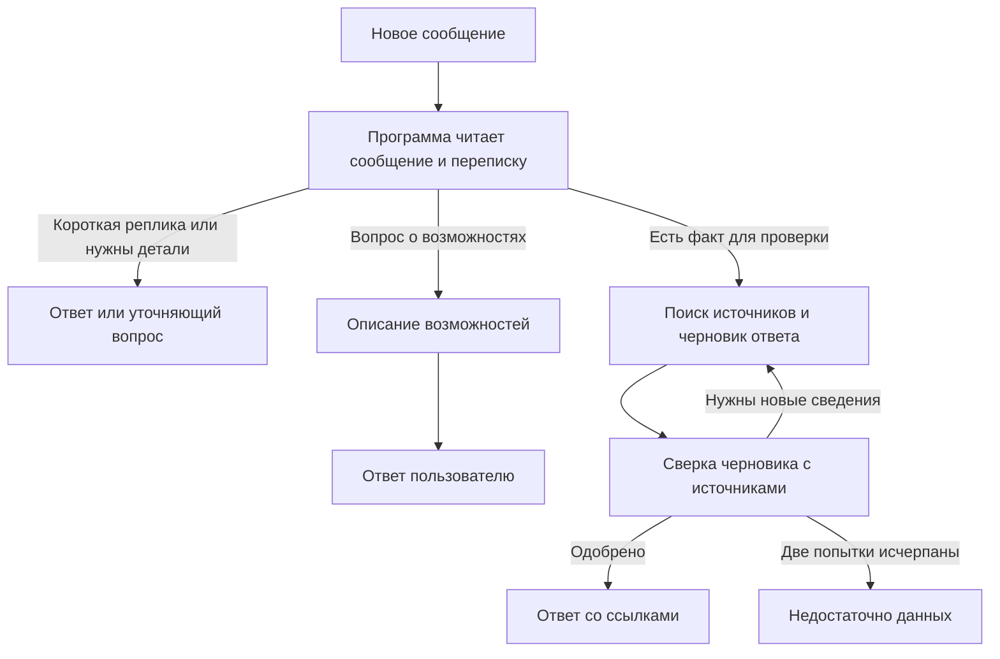

# FactChecker

Проект для проверки фактов. Напишите утверждение или задайте вопрос. Программа найдёт источники, сверит с ними ответ и приведёт ссылки. Например, на вопрос «Кто первым ступил на Луну?» ответ начнётся так: «Нил Армстронг первым ступил на Луну».

## Быстрый запуск на Windows

Установите зависимости командой `uv pip install --python .venv/Scripts/python.exe -r requirements.txt`. Укажите ключ Cloud.ru в `CLOUD_RU_API_KEY`, а ключ Tavily в `TAVILY_API_KEY` в локальном файле `.env`. Программа использует модель `GigaChat/GigaChat-3-Pro` через Cloud.ru.

Если `.venv` и `.env` уже настроены, откройте PowerShell в папке проекта и выполните:

```powershell
.\.venv\Scripts\python.exe main.py
```

После запуска откройте [страницу проверки запросов](http://127.0.0.1:8000/docs). Чтобы остановить программу, нажмите **Ctrl+C** в PowerShell.

## Пример диалога

На [странице проверки запросов](http://127.0.0.1:8000/docs) откройте `POST /chat` и нажмите **Try it out**. Вставьте текст запроса и нажмите **Execute**.

В примере запроса сразу видно поле `"thread_id": null`. Оставьте `null` или удалите поле, чтобы программа создала новый номер беседы. Чтобы продолжить разговор, замените `null` номером из предыдущего ответа в кавычках.

1. Начните с вопроса без названия события. Программа попросит уточнить, о чём речь.

   ```json
   {
     "message": "Проверь, правда ли это произошло в 1969 году.",
     "thread_id": null
   }
   ```

2. Скопируйте значение `thread_id` из первого ответа и отправьте уточнение. Программа возьмёт год из первого сообщения и проверит факт.

   ```json
   {
     "message": "Речь о первой высадке людей на Луну.",
     "thread_id": "НОМЕР_ДИАЛОГА"
   }
   ```

В поле `answer` будет ответ, в `thread_id` — номер диалога, а в `route` — выбранное действие. Значение `clarify` означает короткий ответ или уточнение, `capabilities` — ответ о возможностях программы, `research` — проверку факта.

## Как проходит проверка



Программа ищет и читает страницы через Tavily и дополнительно ищет статьи в Википедии. Для поиска в Википедии ключ не нужен. Затем программа готовит ответ и отдельно сверяет его с прочитанным. Если вывод требует исправлений, она меняет поисковый запрос, ищет ещё раз и заново проверяет ответ.

Чтобы продолжить разговор, передайте тот же `thread_id`. Запрос без этого поля начинает новый разговор. История и состояние беседы сохраняются в `factchecker.sqlite3` и остаются после остановки программы. Путь к файлу можно изменить через `FACTCHECKER_DB` в `.env`.

Например, после вопроса «Кто первым ступил на Луну?» можно спросить «А кто вторым?» с тем же `thread_id`. Программа возьмёт событие из предыдущего вопроса и проверит, кто ступил на Луну вторым.
